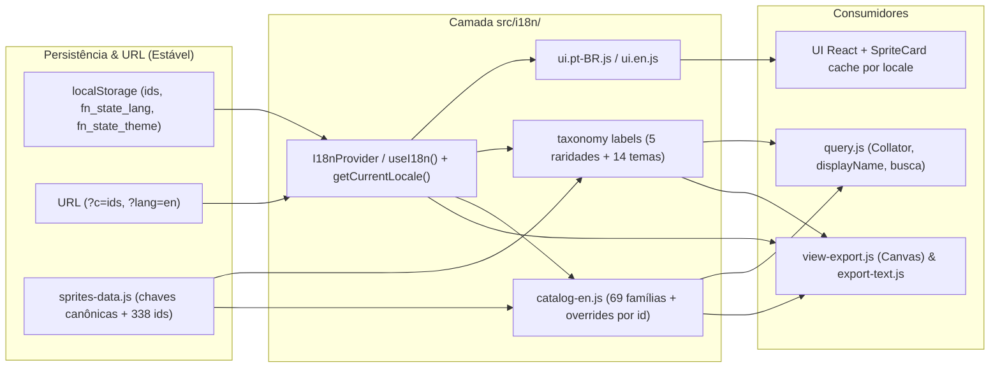

# Plano de Internacionalização (i18n): Suporte ao Inglês (`en`)

Este documento define o planejamento técnico e de produto para adicionar suporte bilíngue (**Português `pt-BR`** + **Inglês `en`**) ao rastreador, mantendo a base pronta para novos idiomas no futuro sem quebrar coleções salvas, backups JSON, URLs compartilhadas (`?c=`) ou scripts de manutenção.

> [!NOTE]
> Este é um **planejamento para atualizações futuras**. Nenhum arquivo do repositório foi alterado nesta etapa. Os itens na seção [Decisões em Aberto](#decis%C3%B5es-em-aberto-para-aprova%C3%A7%C3%A3o) destacam escolhas de produto e arquitetura que precisam da sua definição antes de iniciar a implementação.

---

## 1. Objetivos e Requisitos Não Negociáveis

1. **Idiomas suportados inicialmente:** `pt-BR` e `en`, com fallback seguro para `pt-BR`.
2. **Retrocompatibilidade 100% preservada:**
   - Coleções em `localStorage` (`fn_obtained_sprites`, `fn_mastered_sprites`, filtros e preferências) e backups JSON continuam válidos independente do idioma ativo.
   - Links compartilhados via `?c=...` ([share-codec.js](file:///home/radiant/DevHub/fnpituchinhubr/src/share-codec.js)) já operam exclusivamente sobre `sprite.id` e devem abrir corretamente no idioma de quem visualiza o link.
   - O workflow automático de lançamento ([release-sprites.js](file:///home/radiant/DevHub/fnpituchinhubr/scripts/release-sprites.js)) continua alterando apenas `unreleased` em [sprites-data.js](file:///home/radiant/DevHub/fnpituchinhubr/src/data/sprites-data.js) sem necessidade de sincronização manual extra.
3. **Troca instantânea em runtime:** Alterar o idioma nas configurações atualiza toda a interface, atributos ARIA, `SpriteCard`, título da aba (`document.title`), ordenação (`Intl.Collator`) e exportações (PNG, texto e grade de trocas) sem recarregar a página.
4. **Performance e Bundle mínimo:** Manter `React 19` + `Vite 6` enxutos, com zero regressão no score de carregamento e compatibilidade com `checkJs: true` + `strictNullChecks: true` em [tsconfig.json](file:///home/radiant/DevHub/fnpituchinhubr/tsconfig.json).

---

## 2. Diagnóstico Técnico e Acoplamentos Críticos Encontrados

Uma auditoria completa no código identificou os pontos onde `pt-BR` hoje está acoplado à lógica ou à camada de dados:

### 2.1. Taxonomia com chaves em PT-BR ([taxonomy.js](file:///home/radiant/DevHub/fnpituchinhubr/src/taxonomy.js))
- Os objetos `RARITIES` (5 raridades: `Mítico`, `Lendário`, `Épico`, `Raro`, `Especial`) e `THEME` (14 temas: `Básico`, `Dourado`, `Doce`, `Galáctico`, `Gema`, `Metálico`, `Pato`, `Cubo`, `Trapaceiro`, `Hacker de Saque`, `Caçador de Recompensas`, `Doce ou Travessura`, `Amaldiçoado`, `Valioso`) usam a string de exibição em português **como chave estrutural**.
- Essa mesma string aparece em:
  - `sprite.theme` e `sprite.rarity` dentro de [sprites-data.js](file:///home/radiant/DevHub/fnpituchinhubr/src/data/sprites-data.js#L1-L60);
  - `localStorage` via `KEYS.theme` (`'fn_state_theme'`) em [share-order.js](file:///home/radiant/DevHub/fnpituchinhubr/src/share-order.js);
  - Verificações de lógica como `sprite.rarity === 'Especial'` em [SpriteCard.jsx](file:///home/radiant/DevHub/fnpituchinhubr/src/components/SpriteCard.jsx) e `rarity === 'Especial'` em [view-export.js](file:///home/radiant/DevHub/fnpituchinhubr/src/view-export.js#L341);
  - Classes CSS em [styles.css](file:///home/radiant/DevHub/fnpituchinhubr/styles.css#L1585-L1702) (`.rarity-Especial` e `.rarity-special`, atualmente não há seletores `.theme-*` no CSS).

### 2.2. Cache estático de `SpriteCard` ([SpriteCard.jsx](file:///home/radiant/DevHub/fnpituchinhubr/src/components/SpriteCard.jsx#L6-L35))
- `spriteMetaCache` é um `WeakMap` de nível de módulo indexado **apenas pelo objeto `sprite`**. Ele memoriza textos já montados em português (`collectLabel`, `removeLabel`, `masteredCardLabel`, `unmasterLabel`, `masterTitleLabel`, `rarityLabel`).
- Se o idioma mudar em runtime sem invalidar/separar esse cache por `locale`, os 338 cards manterão `aria-label` e `title` congelados no idioma inicial.

### 2.3. Catálogo de 338 sprites e padrões de nome ([sprites-data.js](file:///home/radiant/DevHub/fnpituchinhubr/src/data/sprites-data.js) e [query.js](file:///home/radiant/DevHub/fnpituchinhubr/src/query.js))
- Existem **338 sprites** divididos em **69 famílias**, e **todas as 69** possuem uma entrada `<familia>_basic`.
- Os **14 sufixos de `id`** (`basic`, `gold`, `candy`, `galaxy`, `gem`, `holofoil`, `quack`, `rift`, `cheat`, `hacker`, `hunter`, `tricktreat`, `cursed`, `jeweled`) mapeiam **1:1** para os 14 temas.
- Porém, nomes têm nuances que impedem tradução literal automática em 100% dos casos:
  - Em `pt-BR`, variantes usam concordância de gênero (`"Apatilda Amaldiçoada"` vs `"Baunardo Amaldiçoado"`, `"Água de Goma"` vs tema `"Doce"`).
  - Nomes localizados pela Epic/comunidade diferem do inglês (`"Embananado"` vs `"Peely"`, `"Peixoto"` vs `"Fishstick"`, `"Escoteiro da Tempestade"`, `"Ponto Zero"`).
  - `getDisplayName(name)` em [query.js](file:///home/radiant/DevHub/fnpituchinhubr/src/query.js#L147-L149) já usa uma heurística mista (`name === 'Burnt Peanut' ? name : \`\${name} Sprite\``), produzindo hoje strings híbridas como `"Água Sprite"`.

### 2.4. Ordenação, Busca e Pluralização ([query.js](file:///home/radiant/DevHub/fnpituchinhubr/src/query.js) e [BatchModal.jsx](file:///home/radiant/DevHub/fnpituchinhubr/src/components/BatchModal.jsx))
- `defaultCollator = new Intl.Collator()` usa o locale padrão do sistema operacional/navegador, em vez do idioma ativo da UI.
- `BatchModal.jsx:64` fixa `localeCompare(b.label, 'pt-BR')` e pluraliza manualmente (`1 sprite selecionado` / `N sprites selecionados`).
- `filterSprites` busca apenas em `sprite.name.toLowerCase()` (e não normaliza acentos nem contempla o nome no outro idioma).

### 2.5. Exportações em Texto e Canvas PNG ([export-text.js](file:///home/radiant/DevHub/fnpituchinhubr/src/export-text.js) e [view-export.js](file:///home/radiant/DevHub/fnpituchinhubr/src/view-export.js))
- [export-text.js](file:///home/radiant/DevHub/fnpituchinhubr/src/export-text.js) já mistura idiomas: títulos em inglês (`LOOKING FOR`, `HAVE`, `STILL NEED TO MASTER`) com resumo e legenda em português (`Colecionados`, `Dominados`, `Link do rastreador`, `✅ Tenho  👑 Dominado  ❌ Não tenho`).
- [view-export.js](file:///home/radiant/DevHub/fnpituchinhubr/src/view-export.js) desenha strings fixas no Canvas (`Rastreador de Pituchinhus`, `Minha coleção`, `Eu procuro estes!`, `Não Dominados`, `Dominados`, `Lista de Trocas`, `Coleção`, `COLETADO`, `DOMINADO`, `FALTANDO`, raridade `.toUpperCase()` e nomes das colunas de tema) — além de toasts de progresso/erro. Textos maiores em inglês ou português precisam caber dentro de `labelW` e dos chips sem estourar (`fitFont` / `fitTextWithEllipsis`).

### 2.6. DOM global, Toasts, HTML e PWA ([dom-utils.js](file:///home/radiant/DevHub/fnpituchinhubr/src/dom-utils.js), [index.html](file:///home/radiant/DevHub/fnpituchinhubr/index.html), [vite.config.js](file:///home/radiant/DevHub/fnpituchinhubr/vite.config.js))
- `#toastContainer` cria `aria-label="Notificações"` fora da árvore React ([dom-utils.js](file:///home/radiant/DevHub/fnpituchinhubr/src/dom-utils.js#L14)).
- `useGamepadAndSpatialNav.js` dispara toasts diretamente fora de componentes React (`Controle ${label} reconhecido` / `desconectado`).
- `<html lang="pt-BR">`, `<title>` e metas `og:*` em [index.html](file:///home/radiant/DevHub/fnpituchinhubr/index.html) e o manifest PWA em [vite.config.js](file:///home/radiant/DevHub/fnpituchinhubr/vite.config.js) são estáticos no build (bots de redes sociais não executam JS para trocar Open Graph).

---

## 3. Arquitetura Proposta

---

## 4. Decisões em Aberto para Aprovação

Antes da execução, confirme sua preferência para os 5 pontos abaixo:

### Decisão 1 — Nomenclatura da Marca em Inglês
Em `pt-BR`, o app usa **"Pituchinhu"** / **"Rastreador de Pituchinhus"**. Em inglês, o termo oficial no Fortnite (e do projeto base `fnsprites`) é **Sprite**.
- **Recomendação:** Em `en`, adotar **"Fortnite Sprites Tracker"** (título principal) / **"sprite(s)"** nos textos, banner e mensagens, mantendo **"Pituchinhu"** intacto em `pt-BR`. Manter os prefixos de arquivo baixado consistentes ou localizados para PNG (ex.: `sprites-collection.png` em `en`, `pituchinhus-collection.png` em `pt-BR`), preservando o nome do JSON de backup (`pituchinhus-backup.json`) para não confundir scripts/hábitos dos usuários.

### Decisão 2 — Estratégia de Chaves na Taxonomia ([taxonomy.js](file:///home/radiant/DevHub/fnpituchinhubr/src/taxonomy.js))
- **Opção A (Recomendada — Desacoplar rótulo mantendo chaves canônicas atuais):** Manter `'Básico'`, `'Dourado'`, `'Raro'`, `'Especial'` etc. como IDs internos em `sprites-data.js` e `localStorage` (`fn_state_theme`), adicionando propriedades localizadas (`labels`, `exportLabels`, `tradeLabels`) na taxonomia e usando os `slug`s já existentes (`mitico`, `especial`, `hacker`...) no CSS quando necessário. **Prós:** zero quebra de `localStorage` existente, zero diff invasivo nas 338 linhas de `sprites-data.js`, zero risco em `release-sprites.js`.
- **Opção B (Migração para slugs ASCII como `'basic'`, `'mythic'`):** Mais limpa conceitualmente, porém altera todo `sprites-data.js`, `styles.css`, `query.test.js` e exige rotina de migração em `useTrackerState.js` para traduzir valores legados salvos em `fn_state_theme`.

### Decisão 3 — Engine de i18n (Módulo Próprio Zero-Dep vs `i18next`)
- **Recomendação:** Criar módulo próprio leve em `src/i18n/` (`~2–4 kB`, sem novas dependências no `package.json`), usando React Context + getter imperativo `t(key, params)` (necessário para `view-export.js`, `dom-utils.js` e `useGamepadAndSpatialNav.js`) + `Intl.PluralRules` e `Intl.Collator`, com verificação de chaves faltantes no `tsc --noEmit` e em teste unitário dedicado.
- *Alternativa:* Instalar `i18next` + `react-i18next` se houver plano de terceirizar traduções via arquivos JSON/Crowdin para muitos idiomas.

### Decisão 4 — Fonte dos Nomes em Inglês do Catálogo (69 famílias + 14 temas)
- **Recomendação:** Estruturar `src/i18n/catalog-en.js` com dicionário das **69 famílias** + regra de composição por **14 sufixos/temas** (ex.: `<Family>` no `basic`, `<Theme> <Family>` ou `<Family> (<Theme>)` conforme padrão oficial do Epic/fnsprites) + **mapa de exceções por `sprite.id`** para casos específicos. Isso permite validar/revisar os nomes oficiais em inglês com a equipe antes do lançamento sem mexer em [sprites-data.js](file:///home/radiant/DevHub/fnpituchinhubr/src/data/sprites-data.js).

### Decisão 5 — Detecção de Idioma, Busca Bilíngue e Exportação de Trocas
- **Detecção inicial (Recomendada):** Ordem `URL (?lang=en|pt-BR)` -> `localStorage ('fn_state_lang')` -> `navigator.languages` / `navigator.language` (`pt*` -> `'pt-BR'`, `en*` -> `'en'`, fallback `'pt-BR'`). Seletor posicionado no modal [SettingsModal.jsx](file:///home/radiant/DevHub/fnpituchinhubr/src/components/SettingsModal.jsx) (`Idioma / Language`).
- **Busca Bilíngue (Recomendada):** Em `filterSprites`, normalizar acentos (`NFD`) e procurar tanto no nome localizado quanto no nome `pt-BR` original (ex.: buscar `"peixoto"` ou `"fishstick"` encontra o mesmo card em ambos os idiomas).
- **Textos de Troca (`export-text.js`):** **Recomendação:** Traduzir 100% os blocos (`LOOKING FOR` / `PROCURANDO`, `HAVE` / `TENHO`, `STILL NEED TO MASTER` / `FALTA DOMINAR`, rodapé e legenda) conforme o idioma ativo, eliminando a mistura atual PT+EN. *(Alternativa: manter tags `LOOKING FOR` / `HAVE` fixas em inglês mesmo na UI em PT-BR para uso em servidores Discord internacionais).*

---

## 5. Plano de Implementação em Fases (Para Execução Futura)

Cada fase abaixo foi desenhada para resultar em um **commit atômico, testável e revisável**, com suíte verde ao final de cada etapa.

### Fase 1 — Fundação de i18n, Persistência de Idioma e Seletor em Configurações
**Objetivo:** Infraestrutura de localização sem alterar textos existentes na UI.
- [ ] Criar `src/i18n/config.js` definindo `SUPPORTED_LOCALES = ['pt-BR', 'en']`, `DEFAULT_LOCALE = 'pt-BR'`, normalização de códigos (`en-US`, `en-GB` -> `'en'`; `pt`, `pt-PT`, `pt-BR` -> `'pt-BR'`).
- [ ] Adicionar `lang: 'fn_state_lang'` ao objeto `KEYS` em [share-order.js](file:///home/radiant/DevHub/fnpituchinhubr/src/share-order.js).
- [ ] Implementar resolução inicial (`?lang=` -> `localStorage` -> `navigator.languages` -> fallback `'pt-BR'`) e sincronização de `document.documentElement.lang` e `document.title`.
- [ ] Criar `src/i18n/index.jsx` com `I18nProvider`, hook `useI18n()` (`{ locale, setLocale, t, formatNumber, plural }`) e API imperativa (`getLocale()`, `translate()`) para módulos não-React (`view-export.js`, `dom-utils.js`, `useGamepadAndSpatialNav.js`).
- [ ] Adicionar o controle de idioma (`Português (BR)` / `English`) dentro de [SettingsModal.jsx](file:///home/radiant/DevHub/fnpituchinhubr/src/components/SettingsModal.jsx) e expor `locale` / `setLocale` via [CatalogPage.jsx](file:///home/radiant/DevHub/fnpituchinhubr/src/pages/CatalogPage.jsx) ou Provider raiz em [App.jsx](file:///home/radiant/DevHub/fnpituchinhubr/src/App.jsx).
- [ ] Adicionar testes unitários para detecção de idioma, fallback e persistência.

### Fase 2 — Desacoplamento da Taxonomia, CSS e Funções de Consulta (`query.js`)
**Objetivo:** Separar chaves internas dos rótulos exibidos sem quebrar `localStorage` nem `sprites-data.js`.
- [ ] Estender `RARITIES` e `THEME` em [taxonomy.js](file:///home/radiant/DevHub/fnpituchinhubr/src/taxonomy.js) com mapas de rótulos localizados (`labels`, `exportLabels`, `tradeLabels`) para `pt-BR` e `en`, preservando os `slug`s e chaves canônicas existentes.
- [ ] Atualizar [query.js](file:///home/radiant/DevHub/fnpituchinhubr/src/query.js) para aceitar `locale` nos helpers de exibição (`getUiRarityLabel`, `getUiThemeLabel`, `getExportThemeLabel`, `getTradeThemeLabel`, `getDisplayName`, `getTranslatedSpriteName`).
- [ ] Parametrizar `Intl.Collator` por `locale` (`'pt-BR'` / `'en'`) em `sortSprites` ([query.js](file:///home/radiant/DevHub/fnpituchinhubr/src/query.js)) e na ordenação de famílias em [BatchModal.jsx](file:///home/radiant/DevHub/fnpituchinhubr/src/components/BatchModal.jsx#L64).
- [ ] Garantir consistência no CSS ([styles.css](file:///home/radiant/DevHub/fnpituchinhubr/styles.css) e [SpriteCard.jsx](file:///home/radiant/DevHub/fnpituchinhubr/src/components/SpriteCard.jsx)) mantendo `.rarity-special` baseado na chave canônica (`sprite.rarity === 'Especial'`) e evitando dependência visual em strings traduzidas.
- [ ] Validar retrocompatibilidade de `KEYS.theme` em `getInitialFilters` ([useTrackerState.js](file:///home/radiant/DevHub/fnpituchinhubr/src/hooks/useTrackerState.js#L54-L73)) e `getSpriteDataIssues`.

### Fase 3 — Dicionários da Interface React, ARIA, Toasts e `SpriteCard`
**Objetivo:** Traduzir 100% da interface interativa, leitores de tela e notificações.
- [ ] Criar `src/i18n/locales/pt-BR.js` e `src/i18n/locales/en.js` com paridade estrita de chaves (verificada em teste e `tsc --noEmit`).
- [ ] Corrigir o cache `spriteMetaCache` em [SpriteCard.jsx](file:///home/radiant/DevHub/fnpituchinhubr/src/components/SpriteCard.jsx#L6-L35) para armazenar metadados estruturais sem texto em um `WeakMap` global e separar/indexar strings ARIA por `locale`, além de traduzir os badges (`NÃO LANÇADO` / `UNRELEASED`, `DOMINADO` / `MASTERED`, `COLETADO` / `COLLECTED`) e `title`/`aria-label`.
- [ ] Localizar todos os componentes:
  - [Header.jsx](file:///home/radiant/DevHub/fnpituchinhubr/src/components/Header.jsx) (título `<h1>`, contadores `Coleção`/`Collection`, `Dominados`/`Mastered`);
  - [FilterBar.jsx](file:///home/radiant/DevHub/fnpituchinhubr/src/components/FilterBar.jsx) e [M3FilterMenu.jsx](file:///home/radiant/DevHub/fnpituchinhubr/src/components/M3FilterMenu.jsx) (`STATUS_PILLS`, `SORT_OPTIONS`, `Tipos`/`Types`, `Temporadas`/`Seasons`, placeholder `Buscar...`/`Search...`, botões e `aria-label`);
  - [ExportModal.jsx](file:///home/radiant/DevHub/fnpituchinhubr/src/components/ExportModal.jsx), [BatchModal.jsx](file:///home/radiant/DevHub/fnpituchinhubr/src/components/BatchModal.jsx) (com pluralização via `Intl.PluralRules`), [SettingsModal.jsx](file:///home/radiant/DevHub/fnpituchinhubr/src/components/SettingsModal.jsx) e [ModalDialog.jsx](file:///home/radiant/DevHub/fnpituchinhubr/src/components/ModalDialog.jsx) (`aria-label` fechar);
  - [ControllerHud.jsx](file:///home/radiant/DevHub/fnpituchinhubr/src/components/ControllerHud.jsx) (`HUD_PROFILES.keyboard`, `Coletar`/`Collect`, `Dominar`/`Master`, rótulos ARIA).
- [ ] Localizar [CatalogPage.jsx](file:///home/radiant/DevHub/fnpituchinhubr/src/pages/CatalogPage.jsx) (banner de visualização compartilhada, link `Ir para meu rastreador`, grid `aria-label`, estados vazios e toasts de exportação, backup, lote + `Desfazer`/`Undo` e compartilhamento).
- [ ] Localizar mensagens imperativas fora do React: [dom-utils.js](file:///home/radiant/DevHub/fnpituchinhubr/src/dom-utils.js) (`aria-label` do `#toastContainer` atualizado quando o idioma muda + aviso de HTTPS ao copiar) e [useGamepadAndSpatialNav.js](file:///home/radiant/DevHub/fnpituchinhubr/src/hooks/useGamepadAndSpatialNav.js) (toasts de controle conectado/desconectado).

### Fase 4 — Catálogo em Inglês (69 Famílias, Temas e Busca Bilíngue)
**Objetivo:** Traduzir nomes de sprites, família na ordenação/lote/troca e habilitar busca amigável nos dois idiomas.
- [ ] Criar `src/i18n/catalog-en.js` mapeando todas as **69 famílias** (`water`, `earth`, `peely`, `fishy`, `treasurechest`, etc.) e os **14 sufixos** de tema, com tabela opcional de exceções por `sprite.id` (ex.: `theburntpeanut_basic`, colaborações e trocadilhos sem equivalência direta).
- [ ] Revisar os nomes oficiais em inglês do Fortnite para todas as 69 famílias (garantindo consistência com o jogo).
- [ ] Ajustar `getCharNameMap` / `resolveCharName` / `getDisplayName` e adicionar `getSpriteName(sprite, locale)` em [query.js](file:///home/radiant/DevHub/fnpituchinhubr/src/query.js) para evitar sufixo duplicado ou inadequado (ex.: `"Água"` em `pt-BR` na grade de trocas vs `"Water Sprite"` ou `"Water"` em `en`).
- [ ] Atualizar `filterSprites` em [query.js](file:///home/radiant/DevHub/fnpituchinhubr/src/query.js) com normalização sem acentos (`NFD`) e busca nos nomes dos dois idiomas (PT + EN).
- [ ] Criar teste de integridade garantindo que **100% das famílias e sufixos** presentes em `baseSprites` (338 itens) possuem tradução mapeada em `en`.

### Fase 5 — Exportação em Canvas PNG (`view-export.js`) e Texto/Grade (`export-text.js`)
**Objetivo:** Exportações 100% coerentes com o idioma selecionado.
- [ ] Atualizar `getExportConfig`, `drawMiniCard` e o renderizador principal de [view-export.js](file:///home/radiant/DevHub/fnpituchinhubr/src/view-export.js) para receber/ler `locale` ativo:
  - Título L1, chips L2 (`Minha coleção` / `My Collection`, `Eu procuro estes!` / `Looking For These!`, etc.), `emptyMsg` e nomes de arquivo;
  - Badges do mini-card (`COLETADO`/`COLLECTED`, `DOMINADO`/`MASTERED`, `FALTANDO`/`MISSING`);
  - Faixa de raridade traduzida e cabeçalhos/linhas da matriz de trocas;
  - Caixas de progresso no cabeçalho (`Coleção`/`Collection`, `Dominados`/`Mastered`) e toasts de status/erro.
- [ ] Validar largura de texto no Canvas (`fitFont`, `fitTextWithEllipsis`, `labelW`, `chipW`) com os textos em inglês mais longos (ex.: `"Bounty Hunter"`, `"Trick or Treat"`, `"Still Need to Master"`).
- [ ] Unificar e localizar [export-text.js](file:///home/radiant/DevHub/fnpituchinhubr/src/export-text.js) (`LOOKING FOR` / `HAVE` / `STILL NEED TO MASTER`, resumo, legenda e rótulo do link) passando `locale` explicitamente por argumento.

### Fase 6 — Metadados HTML/PWA, Documentação e Validação Automatizada
**Objetivo:** Acabamento, SEO básico, documentação para contribuidores e cobertura de testes.
- [ ] Atualizar [index.html](file:///home/radiant/DevHub/fnpituchinhubr/index.html) e [vite.config.js](file:///home/radiant/DevHub/fnpituchinhubr/vite.config.js) conforme decisão de SEO/PWA (manter metadados base em PT-BR ou bilíngues; opcionalmente gerar páginas de entrada `/en/` estáticas no build do Vite caso se deseje `og:title`/`og:description` nativos em inglês para compartilhamento em redes sociais).
- [ ] Atualizar [README.md](file:///home/radiant/DevHub/fnpituchinhubr/README.md) documentando como adicionar novos sprites e suas respectivas chaves de tradução (além da relação com [release-sprites.js](file:///home/radiant/DevHub/fnpituchinhubr/scripts/release-sprites.js)).
- [ ] Expandir a suíte Vitest cobrindo:
  - Paridade de chaves entre `pt-BR` e `en` e cobertura total dos 338 sprites;
  - Troca dinâmica de idioma em componentes React (validando que `SpriteCard` atualiza `aria-label` e `FilterBar`/`Modals` re-renderizam corretamente);
  - Busca bilíngue, ordenação por `locale` e exportações em texto/PNG.
- [ ] Executar validação final obrigatória: `npm run lint` (`eslint` + `tsc --noEmit`), `npm test` e `npm run build`.

---

## 6. Mapa de Arquivos Afetados

| Área | Arquivos Principais | Impacto |
| :--- | :--- | :--- |
| Nova camada i18n | `src/i18n/config.js`, `src/i18n/index.jsx`, `src/i18n/locales/{pt-BR,en}.js`, `src/i18n/catalog-en.js` | Alto (novo módulo central) |
| Taxonomia & Dados | [taxonomy.js](file:///home/radiant/DevHub/fnpituchinhubr/src/taxonomy.js), [query.js](file:///home/radiant/DevHub/fnpituchinhubr/src/query.js), [share-order.js](file:///home/radiant/DevHub/fnpituchinhubr/src/share-order.js) | Alto (chaves estáveis + lookup por locale) |
| Estado & Infra DOM | [useTrackerState.js](file:///home/radiant/DevHub/fnpituchinhubr/src/hooks/useTrackerState.js), [dom-utils.js](file:///home/radiant/DevHub/fnpituchinhubr/src/dom-utils.js), [useGamepadAndSpatialNav.js](file:///home/radiant/DevHub/fnpituchinhubr/src/hooks/useGamepadAndSpatialNav.js) | Médio (persistência + toasts) |
| Interface React | [App.jsx](file:///home/radiant/DevHub/fnpituchinhubr/src/App.jsx), [CatalogPage.jsx](file:///home/radiant/DevHub/fnpituchinhubr/src/pages/CatalogPage.jsx), `src/components/*.jsx` | Médio/Alto (substituição de textos + `SpriteCard` cache) |
| Exportação | [view-export.js](file:///home/radiant/DevHub/fnpituchinhubr/src/view-export.js), [export-text.js](file:///home/radiant/DevHub/fnpituchinhubr/src/export-text.js) | Médio (Canvas + texto/grade) |
| CSS & Metadados | [styles.css](file:///home/radiant/DevHub/fnpituchinhubr/styles.css), [index.html](file:///home/radiant/DevHub/fnpituchinhubr/index.html), [vite.config.js](file:///home/radiant/DevHub/fnpituchinhubr/vite.config.js), [README.md](file:///home/radiant/DevHub/fnpituchinhubr/README.md) | Baixo |
| Testes | `src/*.test.js` existentes + novos testes de i18n/catálogo | Médio (atualização de asserções PT + novos casos EN) |
